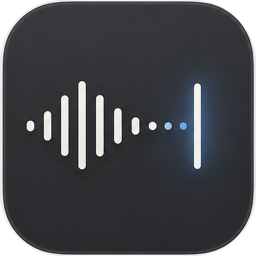

# Epos

Hold fn, speak, release. Epos turns speech into text where you are writing.

Epos is a menu bar dictation app for Apple Silicon Macs running macOS 26 or later.
It uses Apple's SpeechTranscriber for local recognition, then applies personal
vocabulary rules and text cleanup before inserting the final transcript.

## Features

| Feature | What it does |
| --- | --- |
| Hold to dictate | Hold fn to record and release to insert the final text, or record your own hold shortcut. |
| Microphone choice | Follow the system default or pin an input so connecting another microphone does not redirect Epos. |
| Live preview | Show text in the destination field as you speak through the companion input method, or in the recording indicator when the companion is unavailable. |
| Personal vocabulary | Add corrections for names, technical terms, and spoken developer symbols. |
| Text cleanup | Remove fillers such as `um` and repeats such as `the the`. For example, `um, the the 2nd task` becomes `the second task`. |
| Destination checks | Check the original field before inserting. Show a notice when delivery is refused or uncertain. |
| Recording feedback | Follow capture with a microphone meter, start and release sounds, and a configurable screen glow. |

## Install from source

You need an Apple Silicon Mac with macOS 26 or later, Xcode with the macOS 26 or
newer SDK, and Homebrew. The signed installer also needs an Apple Development
certificate, available through Xcode with a free Apple ID.

Quit Epos if it is already running, then run:

```sh
git clone https://github.com/st-eez/epos.git
cd epos
brew install xcodegen
CONFIGURATION=Release scripts/install-signed-app.sh
open /Applications/Epos.app
```

The Release build enables compiler optimizations for daily use. The installer
builds the app and installs the companion used for inline preview.

### First launch

1. Grant Microphone, Speech Recognition, and Accessibility permissions.
2. Let Epos download and prepare the Apple speech asset for its configured language.
3. Disable the macOS Dictation fn shortcut in System Settings, Keyboard, Dictation.
4. If macOS requests consent for the companion input source, grant it. Its first
   registration may also require logging out and back in.

Epos uses the recording indicator while inline preview is unavailable. See
[setup](docs/setup.md) for signing, permissions, and companion registration.

For an install that can fall back to an ad hoc signature, run
`CONFIGURATION=Release scripts/install-local-app.sh` instead. This installer uses
the recording indicator and leaves the companion uninstalled. Permission grants
can be less stable across rebuilds with an ad hoc signature.

## Use Epos

1. Focus the field where you want to write.
2. Hold fn, or your configured shortcut, and speak.
3. Release the shortcut to insert the final text.

Open the menu bar app to edit Corrections, adjust recording feedback, or enable
launch at login. Its Shortcut recorder changes the hold shortcut; Microphone
chooses an input for Epos without changing the system default. A disconnected
chosen microphone stays selected and unavailable until it returns or you choose
another input. If Epos shows `Not inserted`, check the destination and its
permissions before trying again. If it shows `Check the field`, inspect the text
before repeating the dictation because it may already have been inserted.

## Privacy

Speech recognition runs on your Mac. Save audio samples and Learn corrections
are optional settings, both off by default. Enabling them saves recordings or
transcript and edit evidence locally. Turning them off stops new capture;
existing saved material remains.

See [diagnostics](docs/diagnostics.md) for storage locations and logging settings.

## Current limits

Epos uses one configured language, US English by default, without a language
switcher. Inline preview and text insertion
depend on the destination app and its accessibility support. See
[insertion](docs/insertion.md) for selection, focus, and delivery behavior.

Tests cover app logic and native text view safety checks. Daily use still needs
verification with the installed app in your target applications. Latency and
memory acceptance also require live measurements. The
[feature index](docs/readme.md) links implementation evidence and known limits;
[accuracy and performance](docs/accuracy-performance.md) explains the recorded
evaluation results.

## Development

Start with [development](docs/development.md) for build and test commands. The
[feature index](docs/readme.md) maps features to their source and tests.
[AGENTS.md](AGENTS.md) contains contributor instructions, and
[the baseline specification](specs/baseline.md) defines scope and backlog.
